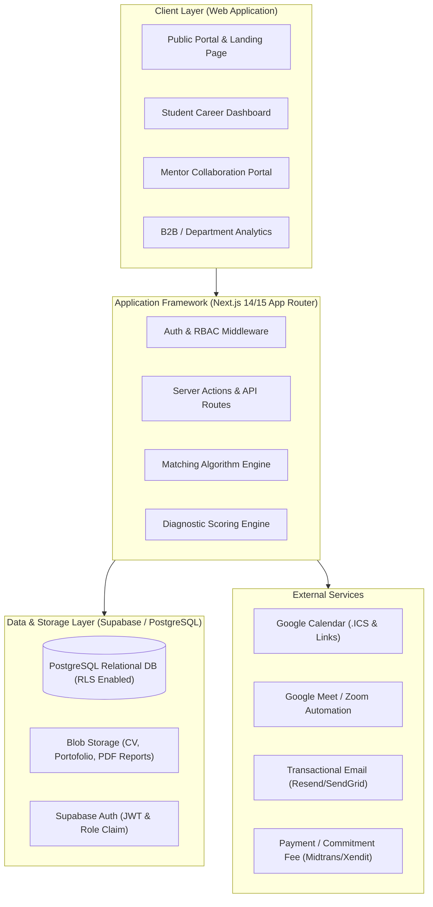
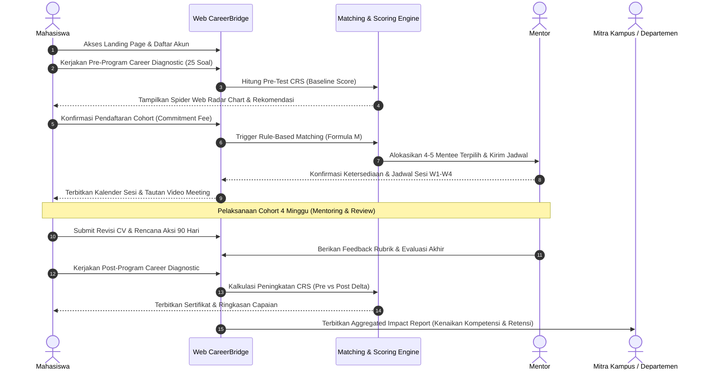
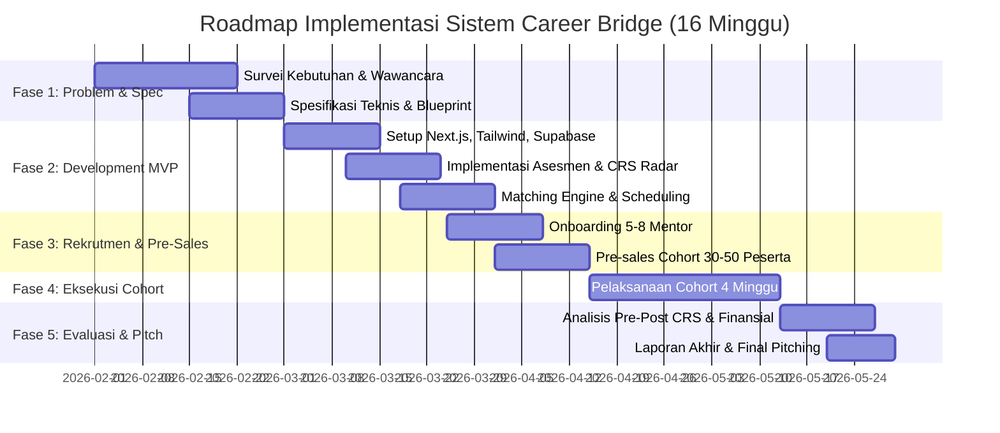

# LAPORAN PERANCANGAN SISTEM & ARSITEKTUR TEKNOLOGI
# WEBSITE "CAREER BRIDGE"
### *Professional Access & Career Readiness Platform*

---

| Metadata Dokumen | Informasi |
| :--- | :--- |
| **Mata Kuliah** | Kewirausahaan Berbasis Teknologi (Kelas 11) |
| **Dosen Pengampu** | Prof. Ridho Bayuaji, S.T., M.T., Ph.D. |
| **Institusi** | Departemen Teknik Elektro, Fakultas Teknologi Elektro dan Informatika Cerdas, Institut Teknologi Sepuluh Nopember (ITS), Surabaya |
| **Tahun Akademik** | 2026 (Periode 1 Semester / 16 Minggu) |
| **Status Dokumen** | Blueprint Rekayasa Sistem & Desain Platform Web (Production-Ready Spec) |

---

## Susunan Tim Pengembang (Kelompok)

| Nama Anggota | NRP | Peran Fungsional & Tanggung Jawab Teknologi |
| :--- | :--- | :--- |
| **Maheswara Yogha Putra Al Ardha** | 5022231188 | **Project Lead & Product Strategist** (Orkestrasi sistem, kemitraan, scope control) |
| **Ardyan Bagas Trihutama** | 5022231171 | **Program & Curriculum Engineer** (Desain kurikulum cohort 4 minggu, learning outcomes) |
| **Thoriq Hilmuddin** | 5022231191 | **Product & Technology Lead** (Arsitektur web full-stack, database, matching engine) |
| **M. Aqila Daffa Arya Bimantara** | 5022231187 | **Professional & Mentor Relations** (Curation pipeline, mentor handbook, onboarding) |
| **Rifky Ananda Riwendra** | 5022231184 | **Quality, Finance & Operations** (Unit economics, metric validation, impact assessment) |

---

## 1. Ringkasan Eksekutif & Karakteristik Bisnis

**Career Bridge** adalah platform pengembangan kesiapan karier berbasis teknologi (*Career Development as a Service*) yang mempertemukan mahasiswa (khususnya bidang teknik, energi, dan industri terkait) dengan para alumni dan praktisi profesional secara terstruktur, kredibel, dan terukur. 

Platform ini **BUKAN** job board/portal lowongan kerja dan **TIDAK** menjanjikan atau menjamin diterimanya magang maupun pekerjaan. Nilai inti yang disediakan adalah:
1. **Career Diagnostic Terstandarisasi**: Mengukur kesiapan karier (*Career Readiness Score / CRS*) sebelum dan sesudah program melalui 5 pilar kompetensi.
2. **Algoritma Professional Matching Terarah**: Memasangkan peserta dengan mentor menggunakan formula pembobotan multi-variabel ($M = 0.30I + 0.25F + 0.20G + 0.15A + 0.10P$).
3. **Struktur Program Cohort 4 Minggu**: Mengombinasikan materi pendampingan terarah, review CV/LinkedIn, mock interview, dan pembuatan rencana tindakan 90 hari (*90-Day Career Action Plan*).
4. **B2B2C Hybrid Model**: Memberdayakan organisasi mahasiswa (seperti pilot awal SPE ITS SC), fakultas, dan departemen kampus untuk mendanai atau mensponsori program cohort dengan jaminan *Impact & Analytics Report*.

---

## 2. Arsitektur Sistem & Pilihan Teknologi (Tech Stack)

Sistem dirancang dengan pendekatan modular, cepat di-deploy untuk tahap MVP satu semester, namun memiliki skalabilitas tinggi untuk ekspansi pascapilot.



### Rincian Pilihan Teknologi:

| Komponen | Teknologi | Justifikasi Teknis |
| :--- | :--- | :--- |
| **Framework Web** | **Next.js 14/15 (App Router, TypeScript)** | SSR/SSG untuk SEO landing page publik, React Server Components (RSC) untuk performa dashboard yang responsif dan aman. |
| **Styling & UI Kit** | **Tailwind CSS + Shadcn UI + Radix UI** | Desain profesional, aksesibel (WCAG 2.1 compliant), konsisten, dan komponen modular yang cepat dikustomisasi. |
| **Icons & Visuals** | **Lucide React + Recharts** | Visualisasi radar chart untuk *Career Readiness Score* dan progress bar visual. |
| **Database & Auth** | **Supabase (PostgreSQL 15+)** | Relational integrity yang ketat, *Row-Level Security (RLS)* untuk proteksi data pribadi CV mahasiswa, autentikasi berbasis role (Mahasiswa, Mentor, Mitra Kampus/Admin). |
| **Form & Validasi** | **React Hook Form + Zod** | Validasi kuesioner asesmen karier dan formulir pendaftaran bebas error runtime. |
| **File Storage** | **Supabase Storage** | Penyimpanan dokumen CV, portofolio, dan sertifikat kelulusan cohort dengan bucket privat berjangka waktu (*signed URLs*). |
| **Deployment** | **Vercel** | Integrasi CI/CD otomatis, zero-configuration HTTPS, edge caching di Asia Tenggara (Singapore). |

---

## 3. Spesifikasi Modul Fungsional Utama

### 3.1 Modul 1: Discovery & Public Landing Page
* **Hero Section**: Value proposition jelas ("Jembatan Nyata Menuju Karier Impian di Industri Teknik & Energi"). CTA utama: *Ikuti Free Career Diagnostic* & *Daftar Cohort Batch 1*.
* **Social Proof & Pilot Showcase**: Dokumentasi bukti awal traction dari *SPE ITS SC Career Coaching Network* (100+ members, alumni mentors).
* **Kurikulum Cohort 4 Minggu**:
  * *Minggu 1*: Career Diagnostic & Goal Setting (Penetapan target & baseline score).
  * *Minggu 2*: Industry & Career Pathway Insight (Pemetaan skill gap posisi target).
  * *Minggu 3*: Strategic Career Preparation (Optimasi CV ATS-friendly, LinkedIn, etika wawancara).
  * *Minggu 4*: Small-Group Mentoring & 90-Day Action Plan Execution.
* **Katalog Profil Mentor**: Kurasi profesional dan alumni dari industri energi, rekayasa, manufaktur, konsultan, dan teknologi.
* **Pricing & B2B Packages**: Transparansi paket mahasiswa individual vs paket kelembagaan (Himpunan Mahasiswa / Departemen).
* **Legal Disclaimer Banner**: Peringatan transparan bahwa Career Bridge adalah program pembinaan kesiapan, bukan agen rekrutmen.

---

### 3.2 Modul 2: Career Diagnostic & Scoring Engine
Peserta mengisi instrumen evaluasi diri 25 butir pertanyaan berbasis skala Likert 1–5 yang mengukur 5 pilar utama:
1. **Career Clarity & Industry Awareness ($W_1 = 20\%$)**: Kejelasan target role, pemahaman standar industri teknik/energi.
2. **Technical & Hard Competency Mapping ($W_2 = 25\%$)**: Kesadaran terhadap kesenjangan skill teknis dan sertifikasi yang dibutuhkan.
3. **Professional Branding ($W_3 = 20\%$)**: Kualitas portofolio, CV berbasis outcome, optimasi profil LinkedIn.
4. **Interview & Professional Communication ($W_4 = 20\%$)**: Kemampuan menyampaikan pengalaman metode STAR, etika bisnis.
5. **Networking Strategy ($W_5 = 15\%$)**: Strategi menjalin relasi profesional dengan alumni dan praktisi.

**Perhitungan Skor Kesiapan Karier (*Career Readiness Score - CRS*):**
$$\text{CRS} = \sum_{k=1}^{5} \left( \frac{\text{Skor Pilar } k}{\text{Maks Skor Pilar } k} \times 100 \right) \times W_k$$

Kategori Hasil:
* **0 – 49**: *Exploration Needed* (Perlu pembekalan dasar dan arah karier).
* **50 – 74**: *Emerging Readiness* (Memiliki dasar yang cukup, membutuhkan pemolesan CV & strategi interview).
* **75 – 100**: *Industry-Ready* (Siap bersaing di bursa rekrutmen profesional).

---

### 3.3 Modul 3: Algoritma Professional Matching Engine
Sistem mencocokkan setiap mentee yang telah membayar atau terdaftar dalam cohort dengan mentor terbaik di database berdasarkan formula pembobotan:

$$M = 0.30 \cdot I + 0.25 \cdot F + 0.20 \cdot G + 0.15 \cdot A + 0.10 \cdot P$$

* $I$ (*Industry Match*): Keselarasan industri target (e.g., Oil & Gas, Renewable Energy, EPC, Heavy Industry, Tech).
* $F$ (*Job Function Match*): Keselarasan fungsi pekerjaan (e.g., Electrical Engineer, Project Engineer, HSE, Business Development).
* $G$ (*Career Goal Stage*): Kesesuaian fokus (e.g., Persiapan magang pertama vs persiapan full-time MT program).
* $A$ (*Time Availability Match*): Keselarasan slot waktu luang (Weekend pagi, Weekend malam, Weekday malam).
* $P$ (*Format Preference*): Preferensi gaya coaching (Review teknikal vs diskusi terarah roadmap).

**Algoritma Pengelompokan**:
Sistem mengelompokkan mentee menjadi kelompok kecil (*small group cohort*: 4–5 mahasiswa per 1 mentor) berdasarkan kemiripan skor vektor untuk menjaga efisiensi operasional dan interaksi mendalam.

---

### 3.4 Modul 4: Dashboard Mahasiswa (Mentee Workspace)
* **Status Cohort**: Progress bar 4 minggu, status tugas mingguan (draft CV, LinkedIn audit, 90-day action plan).
* **Profil Mentor Terpilih**: Informasi pengalaman, link LinkedIn, dan jadwal sesi Google Meet/Zoom berikutnya.
* **CRS Visualizer**: Spider web / Radar chart interaktif yang menampilkan skor pra-program vs pasca-program.
* **Action Plan Tracker**: Lembar kerja interaktif untuk target aksi 90 hari pascaprogram (misal: "Selesaikan sertifikasi AutoCAD", "Kirim 10 koneksi bermakna di LinkedIn").

---

### 3.5 Modul 5: Dashboard Mentor (Professional Portal)
* **Daftar Mentee Terhubung**: Ringkasan hasil diagnostic dan CV dari mentee di kelompoknya.
* **Evaluasi & Feedback Rubrik**: Form standar 5 menit bagi mentor setelah setiap sesi untuk memberikan masukan terstruktur kepada mentee.
* **Jadwal & Token Konfirmasi**: Fleksibilitas konfirmasi kehadiran atau permintaan penyesuaian jadwal (reschedule window H-3).

---

### 3.6 Modul 6: Institutional / B2B Reporting Portal
Ditujukan bagi pengurus Himpunan Mahasiswa Departemen (misal Himatektro ITS), BEM, atau Career Center ITS yang mensponsori mahasiswanya:
* **Aggregated Impact Report**: Rata-rata kenaikan skor kesiapan mahasiswa dari *Pre-test* ke *Post-test* (Target $\ge +20\%$).
* **Attendance & Completion Rate**: Bukti akuntabilitas bahwa program berjalan efektif ($\ge 75\%$ kelulusan).
* **Export PDF**: Unduh laporan pertanggungjawaban program untuk LPJ organisasi atau akreditasi universitas.

---

## 4. Skema Database Relasional (PostgreSQL / Supabase)

Berikut adalah skema tabel relasional utama yang siap diimplementasikan:

```sql
-- 1. Tabel Master Pengguna
CREATE TABLE users (
    id UUID PRIMARY KEY DEFAULT gen_random_uuid(),
    email VARCHAR(255) UNIQUE NOT NULL,
    full_name VARCHAR(255) NOT NULL,
    role VARCHAR(20) NOT NULL CHECK (role IN ('student', 'mentor', 'institution', 'admin')),
    phone VARCHAR(20),
    created_at TIMESTAMP WITH TIME ZONE DEFAULT NOW()
);

-- 2. Profil Mahasiswa
CREATE TABLE student_profiles (
    user_id UUID PRIMARY KEY REFERENCES users(id) ON DELETE CASCADE,
    university VARCHAR(100) DEFAULT 'Institut Teknologi Sepuluh Nopember',
    faculty VARCHAR(100),
    department VARCHAR(100) DEFAULT 'Teknik Elektro',
    batch_year INT NOT NULL,
    current_semester INT NOT NULL,
    target_industry VARCHAR(100),
    target_role VARCHAR(100),
    linkedin_url TEXT,
    cv_file_url TEXT,
    availability_slot VARCHAR(50)
);

-- 3. Profil Mentor
CREATE TABLE mentor_profiles (
    user_id UUID PRIMARY KEY REFERENCES users(id) ON DELETE CASCADE,
    company_name VARCHAR(150) NOT NULL,
    current_title VARCHAR(150) NOT NULL,
    industry_domain VARCHAR(100) NOT NULL,
    job_function VARCHAR(100) NOT NULL,
    years_of_experience INT NOT NULL,
    max_mentee_capacity INT DEFAULT 5,
    bio TEXT,
    is_active BOOLEAN DEFAULT TRUE
);

-- 4. Cohort Management
CREATE TABLE cohorts (
    id UUID PRIMARY KEY DEFAULT gen_random_uuid(),
    cohort_name VARCHAR(100) NOT NULL,
    batch_number INT NOT NULL,
    start_date DATE NOT NULL,
    end_date DATE NOT NULL,
    status VARCHAR(20) DEFAULT 'recruiting' CHECK (status IN ('draft', 'recruiting', 'in_progress', 'completed')),
    target_participants INT DEFAULT 40
);

-- 5. Hasil Career Diagnostic Assessment
CREATE TABLE diagnostic_assessments (
    id UUID PRIMARY KEY DEFAULT gen_random_uuid(),
    student_id UUID REFERENCES users(id) ON DELETE CASCADE,
    cohort_id UUID REFERENCES cohorts(id),
    assessment_type VARCHAR(10) CHECK (assessment_type IN ('pre_test', 'post_test')),
    clarity_score NUMERIC(5,2) NOT NULL,
    competency_score NUMERIC(5,2) NOT NULL,
    branding_score NUMERIC(5,2) NOT NULL,
    interview_score NUMERIC(5,2) NOT NULL,
    networking_score NUMERIC(5,2) NOT NULL,
    overall_crs NUMERIC(5,2) NOT NULL,
    created_at TIMESTAMP WITH TIME ZONE DEFAULT NOW()
);

-- 6. Matching & Alokasi Kelompok
CREATE TABLE mentor_matches (
    id UUID PRIMARY KEY DEFAULT gen_random_uuid(),
    cohort_id UUID REFERENCES cohorts(id),
    mentor_id UUID REFERENCES users(id),
    student_id UUID REFERENCES users(id),
    match_score NUMERIC(4,3) NOT NULL, -- Skor M (0.000 - 1.000)
    assigned_at TIMESTAMP WITH TIME ZONE DEFAULT NOW(),
    UNIQUE(cohort_id, student_id)
);

-- 7. Sesi Pertemuan & Presensi
CREATE TABLE mentoring_sessions (
    id UUID PRIMARY KEY DEFAULT gen_random_uuid(),
    cohort_id UUID REFERENCES cohorts(id),
    mentor_id UUID REFERENCES users(id),
    week_number INT CHECK (week_number BETWEEN 1 AND 4),
    session_title VARCHAR(200) NOT NULL,
    scheduled_at TIMESTAMP WITH TIME ZONE NOT NULL,
    meeting_link TEXT,
    status VARCHAR(20) DEFAULT 'scheduled' CHECK (status IN ('scheduled', 'completed', 'rescheduled', 'cancelled'))
);

CREATE TABLE session_attendances (
    id UUID PRIMARY KEY DEFAULT gen_random_uuid(),
    session_id UUID REFERENCES mentoring_sessions(id) ON DELETE CASCADE,
    student_id UUID REFERENCES users(id),
    attended BOOLEAN DEFAULT FALSE,
    feedback_notes TEXT,
    rating_given INT CHECK (rating_given BETWEEN 1 AND 5)
);

-- 8. 90-Day Career Action Plan
CREATE TABLE action_plans (
    id UUID PRIMARY KEY DEFAULT gen_random_uuid(),
    student_id UUID REFERENCES users(id) ON DELETE CASCADE,
    cohort_id UUID REFERENCES cohorts(id),
    target_milestone_30_days TEXT NOT NULL,
    target_milestone_60_days TEXT NOT NULL,
    target_milestone_90_days TEXT NOT NULL,
    mentor_signoff_notes TEXT,
    created_at TIMESTAMP WITH TIME ZONE DEFAULT NOW()
);
```

---

## 5. Alur Layanan & Interaksi Sistem (Service Blueprint)



---

## 6. Tata Kelola Keamanan, Privasi & Kepatuhan Etis (UU PDP No. 27/2022)

1. **Informed Consent & Akses Terbatas**:
   * Data pribadi, riwayat akademik, CV, dan nomor telepon mahasiswa tidak disebarluaskan secara publik atau ke perusahaan pihak ketiga tanpa persetujuan eksplisit.
   * Mentor hanya dapat mengakses CV dan hasil asesmen dari mentee yang telah resmi dipasangkan dalam cohort aktif.
2. **Disclaimer Eksplisit & Transparansi**:
   * Setiap halaman registrasi, konfirmasi pembayaran, dan footer website wajib memuat *disclaimer hukum*:
     > *"Career Bridge adalah program pembinaan kesiapan dan pendampingan profesional independen. Program ini tidak terafiliasi sebagai agen rekrutmen tenaga kerja serta tidak menjamin kelulusan seleksi magang maupun tawaran pekerjaan di perusahaan mana pun."*
3. **Pemisahan Entitas**:
   * Hubungan dengan organisasi kemahasiswaan mitra (seperti SPE ITS SC) diatur secara kontraktual sebagai *Distribution & Community Partner*, menjaga independensi aset intelektual platform.

---

## 7. Rencana Kerja Semesteran (Roadmap 16 Minggu)



---

## 8. Kriteria Keberhasilan & Decision Gate (Go / Pivot / Stop)

Pada akhir minggu ke-16, tim pengembang dan dosen pengampu akan menilai kelayakan kelanjutan komersial Career Bridge berdasarkan metrik kuantitatif:

| Parameter | Target Minimum (GO) | Hasil Skenario Pivot | Skenario Stop |
| :--- | :--- | :--- | :--- |
| **Peserta Berbayar** | $\ge 30$ Mahasiswa | 15–29 Mahasiswa (Ganti ke model B2B penuh) | $< 15$ Mahasiswa |
| **Peningkatan CRS** | Rata-rata $\ge +20\%$ | $+10\% - +19\%$ (Perbaiki silabus) | $< +10\%$ |
| **Tingkat Kelulusan (Completion)** | $\ge 75\%$ | $50\% - 74\%$ (Penyederhanaan beban tugas) | $< 50\%$ |
| **Kepuasan Peserta & Mentor** | $\ge 85\%$ (Peserta), $\ge 80\%$ (Mentor) | $70\% - 84\%$ | $< 70\%$ |
| **Gross Margin Pilot** | $\ge 30\%$ target operasional | $10\% - 29\%$ (Optimalisasi biaya mentor) | Margin Negatif berkelanjutan |
